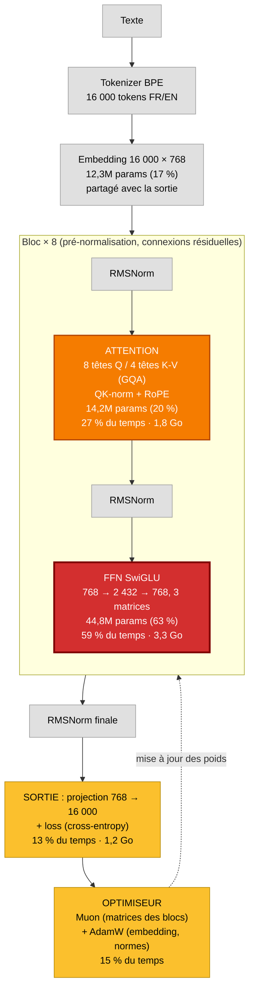
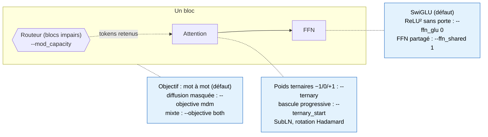
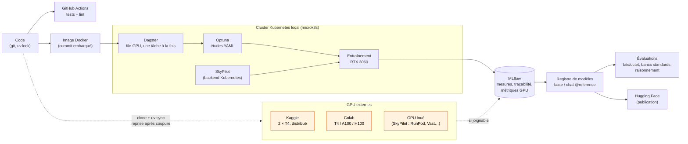

# MiniMind FR/EN — entraîner et étudier un petit modèle de langue sur une seule carte graphique

Un modèle de langue bilingue français / anglais de **71 millions de paramètres**, entraîné depuis zéro sur
une RTX 3060 (12 Go), et surtout le **journal d'expériences** qui l'accompagne : vingt-deux études rédigées,
menées avec le même protocole, bruit de mesure compris, résultats négatifs compris.

Le code de départ est celui de [MiniMind](https://github.com/jingyaogong/minimind) (Apache 2.0), un projet
pédagogique en PyTorch pur. Ce dépôt y ajoute la démarche expérimentale, la chaîne de données bilingue,
des variantes d'architecture et l'outillage : Dagster, Optuna et MLflow sur un cluster Kubernetes local,
SkyPilot pour les GPU loués, Kaggle et Colab pour les GPU gratuits, tests et intégration continue.

## Résultats en bref

| Question | Résultat |
|---|---|
| Que gagne-t-on sans toucher au modèle ? | val_loss **2,95 → 2,35** à budget égal (50M tokens) : taille de batch, optimiseur Muon, réglages. Plus qu'un doublement des données (0,49). |
| Les techniques publiées tiennent-elles à petite échelle ? | **Une sur six.** Muon tient ; noyaux Liger, calendrier WSD, plafonnement des logits, matrices structurées et couche mémoire n'apportent rien de mesurable. |
| Que vaut le modèle bilingue ? | 1,02 milliard de tokens, 7 h 54 d'entraînement. En français, il prédit mieux que SmolLM2-360M, cinq fois plus gros (tableau ci-dessous). |
| Peut-on en faire un assistant ? | Oui pour la forme : français fluide, format de conversation acquis. Non pour le fond : répétitions, pas de raisonnement à plusieurs étapes. |
| Poids à trois valeurs (−1, 0, +1) ? | À taille égale : +0,10 de loss après réglage (taux d'apprentissage ×2). Agrandi à 104M paramètres, le ternaire comble la moitié de l'écart pour un modèle trois fois plus léger que le 16 bits. Les techniques de compression publiées (échelles par groupe, rotation de Hadamard) n'aident pas depuis zéro. |
| Peut-on accélérer l'entraînement ? | Pas gratuitement sur cette carte : les réglages système ne rapportent rien, et à temps de calcul égal aucune variante ne bat le modèle d'origine. Le routage des tokens (Mixture-of-Depths) accélère de 33 % pour un peu de loss ; un défaut de compilation qui lui coûtait 15 minutes au démarrage a été trouvé et contourné. |
| Et à 150M paramètres ? | Sur un budget court, le 150M fait déjà mieux que le 71M (−0,087 de loss) ; il demanderait 14 à 20 h par milliard de tokens sur la RTX 3060, d'où l'usage de GPU externes. |
| Les GPU gratuits sont-ils utilisables ? | Oui en fp16 : même loss qu'en bf16 à 0,001 près. Une T4 va à 58 % de la RTX 3060 ; les deux T4 de Kaggle, en entraînement distribué, s'en approchent. |
| Faut-il partir de zéro ? | Non, si un modèle de même architecture existe : un 150M taillé dans Qwen3-0.6B (vocabulaire réduit, 8 blocs sur 28) dépasse notre 71M de 8 h après 2 h d'entraînement, soit environ 4 fois moins de temps à qualité égale. |
| Que vaut un simple comptage du corpus ? | Seul, le niveau de 9 minutes d'entraînement. En complément d'un modèle, −0,045 bit/octet pour quelques minutes de processeur : plus qu'un doublement du modèle. |

Toutes les mesures sont accompagnées de leur repère dans les [fiches d'études](docs/etudes/README.md).

### Comparaison avec des modèles publics

Bits par octet sur cinq jeux de test tenus à l'écart de l'entraînement (plus bas = mieux). Cette mesure
est comparable entre modèles aux tokenizers différents.

| Jeu de test | **Ce modèle, 71M** | SmolLM2 135M | SmolLM2 360M | LFM3 1,7B | CroissantLLM 1,3B |
|---|---|---|---|---|---|
| Web français courant | 1,126 | 1,566 | 1,403 | 1,068 | **0,801** |
| Web français sélectionné | 1,088 | 1,465 | 1,292 | 0,924 | **0,762** |
| Wikisource (littérature, absent de tous nos corpus) | 1,265 | 1,551 | 1,400 | 1,091 | **0,734** |
| Wikipédia en français | 0,607 | 1,111 | 1,045 | 0,513 | **0,329** |
| Web anglais éducatif | 1,120 | 0,853 | **0,792** | 0,811 | 0,821 |

À lire avec trois réserves. Les modèles comparés ont vu mille fois plus de texte ; SmolLM2 est entraîné
surtout en anglais, ce qui explique son retard en français. Wikipédia est un terrain favorable à notre
modèle, qui en a beaucoup vu. En anglais, il est nettement derrière tous les autres.

**Bancs standards** (lm-evaluation-harness, précision en %, plus haut = mieux ; `trainer/eval_bench.py`) :

| Épreuve | Hasard | **Ce modèle, 71M** | SmolLM2 135M | SmolLM2 360M | CroissantLLM 1,3B |
|---|---|---|---|---|---|
| Grammaire française (french_bench) | 25 | **61,3** | 42,9 | 44,5 | 77,3 |
| Vocabulaire français (french_bench) | 25 | **58,0** | 30,3 | 37,0 | 78,2 |
| Implication entre phrases, FR (XNLI) | 33 | **39,6** | 35,3 | 37,1 | 48,8 |
| Suite plausible, FR (HellaSwag) | 25 | 28,1 | 29,1 | 31,8 | 50,3 |
| Questions de sciences, FR (ARC) | 25 | 23,8 | 23,6 | 26,7 | 30,5 |
| Compréhension de texte, FR (Belebele) | 25 | 23,3 | 22,3 | 24,6 | 26,8 |
| Suite plausible, EN (HellaSwag) | 25 | 27,7 | 43,2 | 56,3 | 53,7 |
| Questions de sciences, EN (ARC facile) | 25 | 38,2 | 58,7 | 67,9 | 50,6 |
| Bon sens physique, EN (PIQA) | 50 | 57,0 | 68,6 | 72,1 | 71,3 |
| Questions de sciences, EN (SciQ) | 25 | 55,4 | 78,6 | 86,5 | 80,0 |

En français, le modèle maîtrise la **langue** (grammaire, vocabulaire) mieux que SmolLM2-360M, cinq fois plus
gros ; il reste au niveau du hasard sur le **raisonnement et les connaissances** (HellaSwag, ARC, Belebele),
comme les SmolLM2. En anglais, il est nettement derrière : 35 % de son corpus seulement, et peu de tokens.

### Ce que le modèle sait faire, et ne sait pas faire

Après ajustement sur 775 000 conversations (val_loss 4,4 → 1,30) :

> **Quelle est la capitale de la France et pourquoi est-elle célèbre ?**
> Paris est la capitale de la France. Elle est la capitale de la France, la plus grande ville du pays et la plus grande ville du pays.

> **Paul a 5 pommes. Il en mange 2. Il en achète 4. Combien de pommes a-t-il maintenant ?**
> Paul a maintenant 5 pommes. Il en mange 2, donc il lui en reste : 5 − 2 = 3 pommes. *(faux : 7)*

C'est le niveau attendu à cette taille, et le point de départ des essais d'architecture en cours. Le modèle
de 71M sert d'étalonnage : méthode, mesures et coûts, avant de passer à 150M paramètres.

## Le modèle

Un transformer décodeur dans le style de Qwen3. Les couleurs indiquent où part le calcul d'un pas
d'entraînement (mesure par retrait de chaque composant, `trainer/profile_components.py`).



Les parts ne s'additionnent pas exactement : la compilation fusionne des opérations voisines. Le FFN
concentre 63 % des paramètres et 59 % du temps, d'où les études qui portent sur lui.

**Variantes disponibles**, chacune derrière une option de `train_pretrain.py` et mesurée dans une étude :



**Recette d'entraînement** : Muon (0,01) pour les matrices des blocs, AdamW (7e-4) pour l'embedding et les
normes, warmup 2 %, décroissance en cosinus, weight decay 0,1, lots de 64 séquences de 340 tokens
assemblées bout à bout (*packing*), précision mixte bf16, `torch.compile`.

## La démarche

- **Une question par étude**, un protocole écrit avant le run, une conclusion chiffrée, des limites.
- **Le bruit est mesuré** : 0,012 de val_loss entre deux graines. Un écart plus petit n'est pas interprété.
- **Budget fixe** : un essai standard dure 20 minutes (50M tokens) ; une loi d'échelle ajustée sur des runs
  courts a prédit la loss du run long (2,006 obtenu, plage prédite 1,89 à 2,18).
- **La validation a été corrigée** avant toute comparaison : le découpage d'origine ne contenait que de
  l'anglais.
- **Les résultats négatifs sont publiés** au même titre que les autres.

Les fiches : [docs/etudes](docs/etudes/README.md) — débit, validation et bruit, réglages, taille de batch,
Muon, loi d'échelle, architecture, matrices structurées, couche mémoire, compression, poids ternaires,
ajustement en conversation, évaluation et raisonnement, corpus, plateforme, ternaire (suite), accélération,
routage des tokens, modèle de 150M, GPU externes, diffusion et hybride, industrialisation, distillation et
répétition, tables de n-grammes, héritage, comptage.

## Les données

| Usage | Sources | Volume | Licences |
|---|---|---|---|
| Pré-entraînement | Wikipédia FR, FineWeb-2 (français), FineWeb-Edu (anglais) | 1,02 milliard de tokens, 65 % de français | CC BY-SA, ODC-By |
| Variante « web sélectionné » | FineWeb2-HQ à la place de FineWeb-2 | idem | ODC-By |
| Conversations | SmolTalk, SmolTalk2, OpenHermes-fr, French Instruct, French Alpaca, OpenAssistant, Dolly | 775 000 conversations, 62 % de français | Apache 2.0, ODC-By, MIT, CC BY-SA 3.0 (Dolly) |
| Test | cinq jeux de 1 000 documents jamais lus par la construction des corpus | — | — |

Construction reproductible : `corpus/pretrain_sources.py`, `corpus/mix.py`, `corpus/sft_sources.py`,
`corpus/testset.py`.

## Reproduire

```bash
uv sync                                         # Python 3.12, PyTorch 2.14 (CUDA 13.0)

python -m corpus.pretrain_sources               # télécharge et nettoie les sources (lecture en flux)
python -c "from corpus.mix import mix, train_tokenizer; mix(0.65); train_tokenizer(0.65)"
python -m corpus.testset                        # jeux de test communs

cd trainer
python study.py etudes/fr_en_court.yaml         # une étude = un fichier YAML (Optuna) ; ici 20 minutes
python study.py etudes/fr_en_full.yaml          # run complet, ~8 h sur une RTX 3060
python -m corpus.sft_sources && python study.py etudes/sft_fr_en_full.yaml   # conversations, ~5 h

python eval_cross.py moi=../out/etude_fr-en-full/fr-en-full-t0_768.pth smollm2=hf:HuggingFaceTB/SmolLM2-135M
python eval_bench.py moi=registre:minimind-fr-en-base@reference --taches francais   # bancs standards
python eval_reasoning.py ../out/etude_sft-fr-en-full/sft-fr-en-full-t0_768_best.pth \
       --tokenizer_path ../dataset/fr_en/tokenizer_fr65_16k --langs fr,en
cd ..

uv run pytest -q tests                          # 10 tests : un pas, reprise exacte, mode distribué, variantes…
sky launch -c mm sky/entrainement.yaml --infra kubernetes     # même entraînement via SkyPilot
scripts/kaggle.sh lancer train NOM "options"    # sur les GPU gratuits de Kaggle (reprise automatique)
python scripts/enregistrer_modele.py --nom minimind-fr-en-base --poids … --run …   # registre de modèles
```

Chaque run écrit dans MLflow (`MINIMIND_MLFLOW_URI`) ses courbes, ses paramètres, la charge du GPU et sa
traçabilité : commit du code, image, empreinte des données et du tokenizer.

## Organisation du dépôt

| Dossier | Contenu |
|---|---|
| `model/` | le modèle, découpé par composant (attention, FFN, normes, RoPE, poids ternaires, couche mémoire) et commenté |
| `trainer/` | entraînement (`train_pretrain.py`), études Optuna (`study.py`, `etudes/*.yaml`), évaluations, profilage |
| `corpus/` | construction des corpus et des jeux de test |
| `orchestration/`, `deploy/` | jobs Dagster sur Kubernetes, file d'attente du GPU, image Docker |
| `sky/`, `cloud/`, `scripts/` | tâche SkyPilot, script exécuté sur les GPU distants, lanceurs Kaggle et Colab, registre de modèles |
| `tests/`, `.github/` | tests de fumée et intégration continue (GitHub Actions) |
| `docs/etudes/` | les fiches d'études |

## Plateforme



- **Local** : les études tournent en jobs Dagster, une à la fois sur le GPU ; une classe de priorité libère
  le GPU quand un entraînement démarre. Détails : [fiche 15](docs/etudes/15-plateforme.md).
- **Externe** : le même script s'exécute sur Kaggle, Colab ou un GPU loué. Il clone le dépôt, recrée
  l'environnement exact (`uv.lock`), reprend au dernier point de sauvegarde, et s'arrête proprement avant la
  fin d'une session. La reprise est vérifiée pas à pas, y compris en mode distribué.
- **Robustesse** : une panne du serveur de suivi n'interrompt pas un entraînement (mesures perdues,
  calcul poursuivi).

## État et suite

- En cours : run complet du 71M sur le corpus « web sélectionné », sur les deux T4 de Kaggle ; évaluation sur
  les bancs standards.
- À venir : passage à 150M paramètres (objectif : moins de 16 h par milliard de tokens, idéalement 8 h),
  publication des poids et de la fiche du modèle sur Hugging Face, essais d'architecture orientés
  raisonnement (blocs réutilisés en boucle), corpus avec du code.

## Crédits et licence

- Code de départ : [MiniMind](https://github.com/jingyaogong/minimind) de Jingyao Gong, licence Apache 2.0,
  conservée ici. La documentation du projet d'origine se trouve dans son dépôt.
- Études, outillage d'expérimentation, chaîne de données bilingue et variantes testées : propres à ce dépôt.
- Les expériences ont été menées avec l'assistance d'un agent de programmation (Claude Code) ; les
  orientations, les arbitrages et la relecture des résultats sont ceux de l'auteur.
