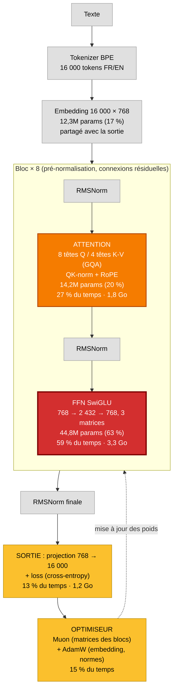

# MiniMind FR/EN — entraîner et étudier un petit modèle de langue sur une seule carte graphique

Un modèle de langue bilingue français / anglais de **71 millions de paramètres**, entraîné depuis zéro sur
une RTX 3060 (12 Go), et surtout le **journal d'expériences** qui l'accompagne : quinze études rédigées (d'autres
en cours), menées avec le même protocole, bruit de mesure compris, résultats négatifs compris.

Le code de départ est celui de [MiniMind](https://github.com/jingyaogong/minimind) (Apache 2.0), un projet
pédagogique en PyTorch pur. Ce dépôt y ajoute la démarche expérimentale, la chaîne de données bilingue,
des variantes d'architecture et l'outillage (Dagster, Optuna, MLflow).

## Résultats en bref

| Question | Résultat |
|---|---|
| Que gagne-t-on sans toucher au modèle ? | val_loss **2,95 → 2,35** à budget égal (50M tokens) : taille de batch, optimiseur Muon, réglages. Plus qu'un doublement des données (0,49). |
| Les techniques publiées tiennent-elles à petite échelle ? | **Une sur six.** Muon tient ; noyaux Liger, calendrier WSD, plafonnement des logits, matrices structurées et couche mémoire n'apportent rien de mesurable. |
| Que vaut le modèle bilingue ? | 1,02 milliard de tokens, 7 h 54 d'entraînement. En français, il prédit mieux que SmolLM2-360M, cinq fois plus gros (tableau ci-dessous). |
| Peut-on en faire un assistant ? | Oui pour la forme : français fluide, format de conversation acquis. Non pour le fond : répétitions, pas de raisonnement à plusieurs étapes. |
| Poids à trois valeurs (−1, 0, +1) ? | Modèle six fois plus petit pour 8 % de loss en plus ; travaux en cours pour agrandir le modèle à mémoire égale. |

Toutes les mesures sont accompagnées de leur repère dans les [fiches d'études](docs/etudes/README.md).

### Comparaison avec des modèles publics

Bits par octet sur cinq jeux de test tenus à l'écart de l'entraînement (plus bas = mieux). Cette mesure
est comparable entre modèles aux tokenizers différents.

| Jeu de test | **Ce modèle, 71M** | SmolLM2 135M | SmolLM2 360M | LFM3 1,7B | CroissantLLM 1,3B |
|---|---|---|---|---|---|
| Web français courant | 1,126 | 1,566 | 1,403 | 1,068 | **0,801** |
| Web français sélectionné | 1,088 | 1,465 | 1,292 | 0,924 | **0,762** |
| Wikisource (littérature, absent de tous nos corpus) | 1,265 | 1,551 | 1,400 | 1,091 | **0,734** |
| Wikipédia en français | 0,607 | 1,111 | 1,045 | 0,513 | **0,329** |
| Web anglais éducatif | 1,120 | 0,853 | **0,792** | 0,811 | 0,821 |

À lire avec trois réserves. Les modèles comparés ont vu mille fois plus de texte ; SmolLM2 est entraîné
surtout en anglais, ce qui explique son retard en français. Wikipédia est un terrain favorable à notre
modèle, qui en a beaucoup vu. En anglais, il est nettement derrière tous les autres.

### Ce que le modèle sait faire, et ne sait pas faire

Après ajustement sur 775 000 conversations (val_loss 4,4 → 1,30) :

> **Quelle est la capitale de la France et pourquoi est-elle célèbre ?**
> Paris est la capitale de la France. Elle est la capitale de la France, la plus grande ville du pays et la plus grande ville du pays.

> **Paul a 5 pommes. Il en mange 2. Il en achète 4. Combien de pommes a-t-il maintenant ?**
> Paul a maintenant 5 pommes. Il en mange 2, donc il lui en reste : 5 − 2 = 3 pommes. *(faux : 7)*

C'est le niveau attendu à cette taille, et le point de départ des essais d'architecture en cours.

## Le modèle

Un transformer décodeur dans le style de Qwen3. Les couleurs indiquent où part le calcul d'un pas
d'entraînement (mesure par retrait de chaque composant, `trainer/profile_components.py`).



Les parts ne s'additionnent pas exactement : la compilation fusionne des opérations voisines. Le FFN
concentre 63 % des paramètres et 59 % du temps, d'où les études qui portent sur lui.

**Recette d'entraînement** : Muon (0,01) pour les matrices des blocs, AdamW (7e-4) pour l'embedding et les
normes, warmup 2 %, décroissance en cosinus, weight decay 0,1, lots de 64 séquences de 340 tokens
assemblées bout à bout (*packing*), précision mixte bf16, `torch.compile`.

## La démarche

- **Une question par étude**, un protocole écrit avant le run, une conclusion chiffrée, des limites.
- **Le bruit est mesuré** : 0,012 de val_loss entre deux graines. Un écart plus petit n'est pas interprété.
- **Budget fixe** : un essai standard dure 20 minutes (50M tokens) ; une loi d'échelle ajustée sur des runs
  courts a prédit la loss du run long (2,006 obtenu, plage prédite 1,89 à 2,18).
- **La validation a été corrigée** avant toute comparaison : le découpage d'origine ne contenait que de
  l'anglais.
- **Les résultats négatifs sont publiés** au même titre que les autres.

Les fiches : [docs/etudes](docs/etudes/README.md) — débit, validation et bruit, réglages, taille de batch,
Muon, loi d'échelle, architecture, matrices structurées, couche mémoire, compression, poids ternaires,
ajustement en conversation, évaluation et raisonnement, corpus, plateforme.

## Les données

| Usage | Sources | Volume | Licences |
|---|---|---|---|
| Pré-entraînement | Wikipédia FR, FineWeb-2 (français), FineWeb-Edu (anglais) | 1,02 milliard de tokens, 65 % de français | CC BY-SA, ODC-By |
| Variante « web sélectionné » | FineWeb2-HQ à la place de FineWeb-2 | idem | ODC-By |
| Conversations | SmolTalk, SmolTalk2, OpenHermes-fr, French Instruct, French Alpaca, OpenAssistant, Dolly | 775 000 conversations, 62 % de français | Apache 2.0, ODC-By, MIT, CC BY-SA 3.0 (Dolly) |
| Test | cinq jeux de 1 000 documents jamais lus par la construction des corpus | — | — |

Construction reproductible : `corpus/pretrain_sources.py`, `corpus/mix.py`, `corpus/sft_sources.py`,
`corpus/testset.py`.

## Reproduire

```bash
uv sync                                         # Python 3.12, PyTorch 2.14 (CUDA 13.0)

python -m corpus.pretrain_sources               # télécharge et nettoie les sources (lecture en flux)
python -c "from corpus.mix import mix, train_tokenizer; mix(0.65); train_tokenizer(0.65)"
python -m corpus.testset                        # jeux de test communs

cd trainer
python study.py etudes/fr_en_court.yaml         # une étude = un fichier YAML (Optuna) ; ici 20 minutes
python study.py etudes/fr_en_full.yaml          # run complet, ~8 h sur une RTX 3060
python -m corpus.sft_sources && python study.py etudes/sft_fr_en_full.yaml   # conversations, ~5 h

python eval_cross.py moi=../out/etude_fr-en-full/fr-en-full-t0_768.pth smollm2=hf:HuggingFaceTB/SmolLM2-135M
python eval_reasoning.py ../out/etude_sft-fr-en-full/sft-fr-en-full-t0_768_best.pth \
       --tokenizer_path ../dataset/fr_en/tokenizer_fr65_16k --langs fr,en
```

Chaque run écrit ses courbes et ses paramètres dans MLflow (`MINIMIND_MLFLOW_URI`).

## Organisation du dépôt

| Dossier | Contenu |
|---|---|
| `model/` | le modèle, découpé par composant (attention, FFN, normes, RoPE, poids ternaires, couche mémoire) et commenté |
| `trainer/` | entraînement (`train_pretrain.py`), études Optuna (`study.py`, `etudes/*.yaml`), évaluations, profilage |
| `corpus/` | construction des corpus et des jeux de test |
| `orchestration/`, `deploy/`, `scripts/` | jobs Dagster sur Kubernetes, file d'attente du GPU, image Docker |
| `docs/etudes/` | les fiches d'études |

## Plateforme

Les études tournent en jobs Dagster sur un cluster Kubernetes à une machine (microk8s), une à la fois sur
le GPU ; Optuna décrit les campagnes, MLflow garde les mesures. Une classe de priorité libère le GPU
lorsqu'un entraînement démarre. Détails : [fiche 15](docs/etudes/15-plateforme.md).

## État et suite

- En cours : poids ternaires (recette et architecture adaptées, puis agrandissement à mémoire égale),
  variantes du FFN.
- À venir : publication des poids et de la fiche du modèle sur Hugging Face, essais d'architecture
  orientés raisonnement, passage à ~150M paramètres.

## Crédits et licence

- Code de départ : [MiniMind](https://github.com/jingyaogong/minimind) de Jingyao Gong, licence Apache 2.0,
  conservée ici. La documentation du projet d'origine se trouve dans son dépôt.
- Études, outillage d'expérimentation, chaîne de données bilingue et variantes testées : propres à ce dépôt.
- Les expériences ont été menées avec l'assistance d'un agent de programmation (Claude Code) ; les
  orientations, les arbitrages et la relecture des résultats sont ceux de l'auteur.
